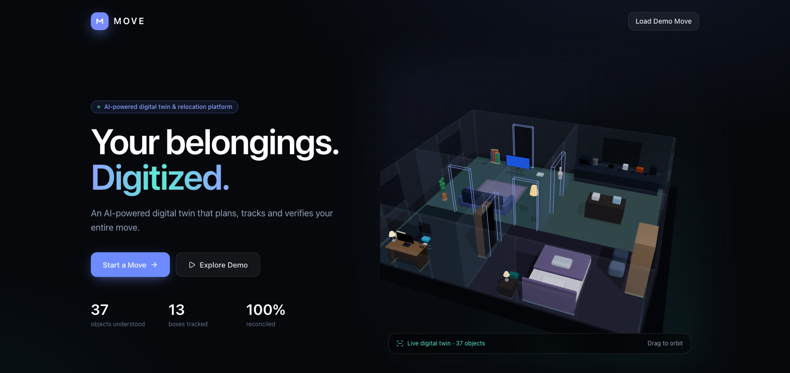
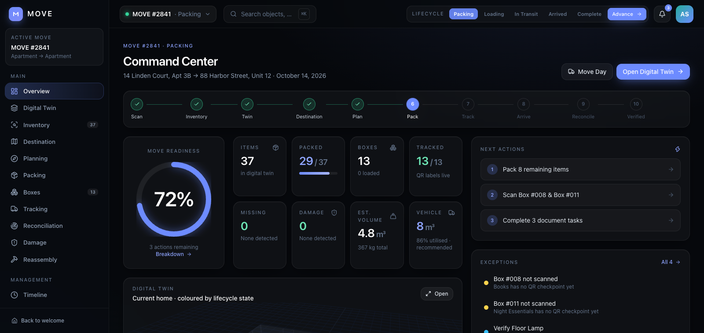
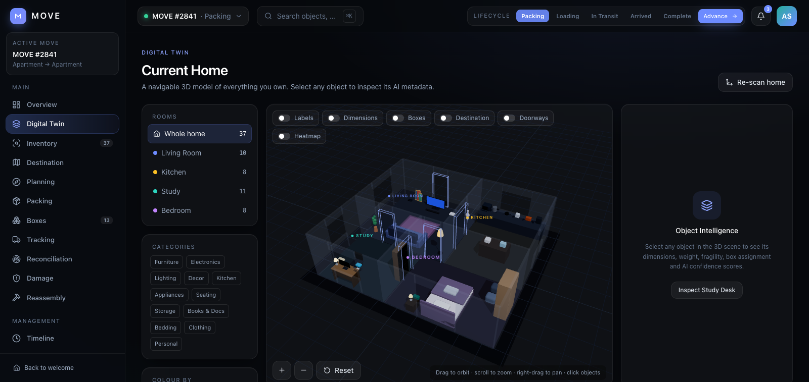
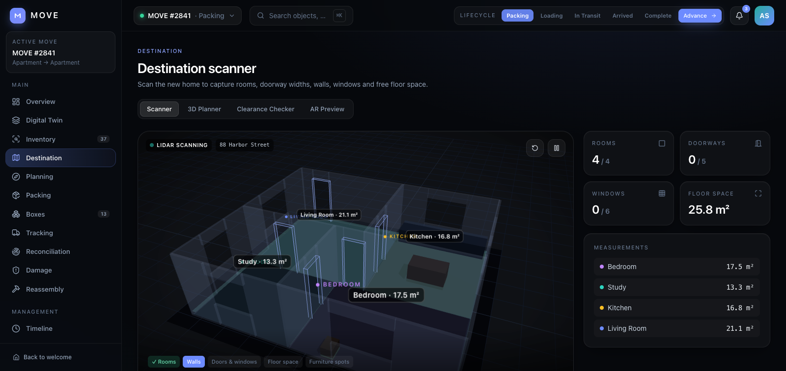
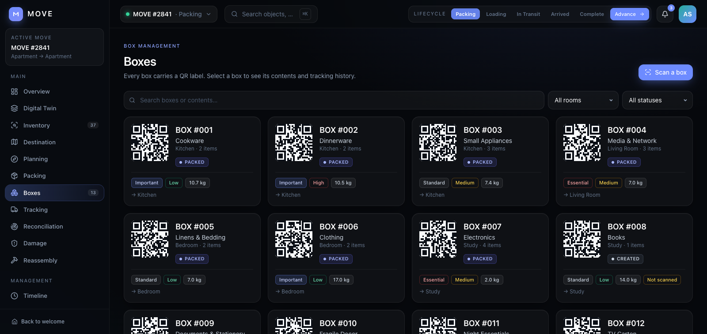
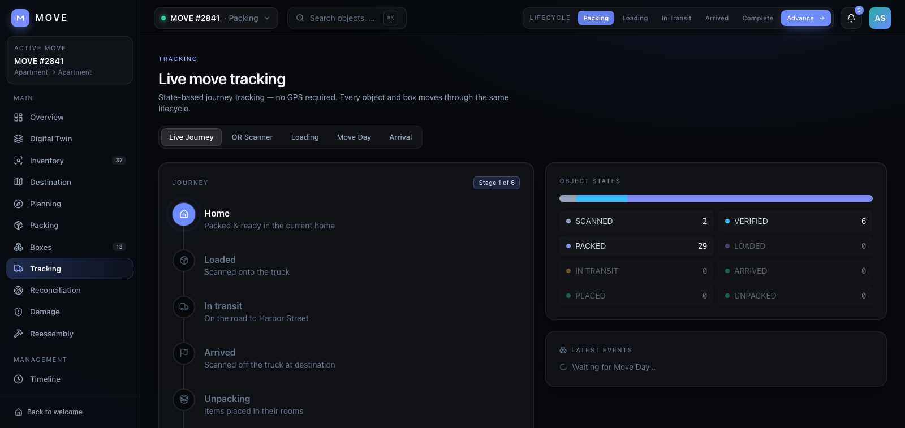
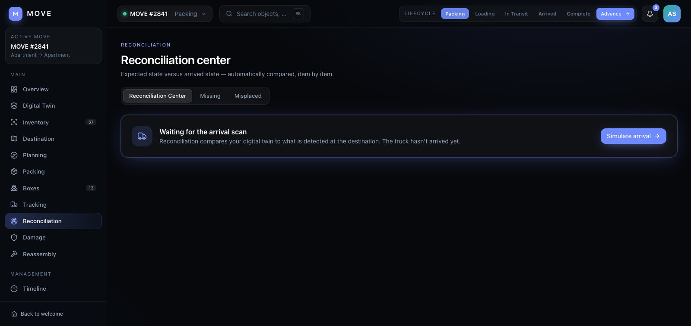
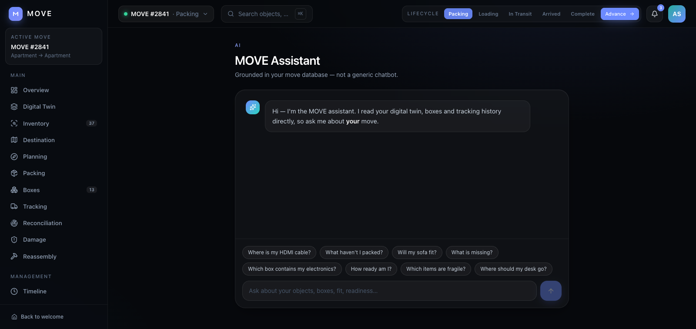

<div align="center">



<h1>MOVE</h1>
<p><strong>AI-Powered Digital Twin & Intelligent Relocation Platform</strong></p>

<p>
  
  
  
  
  
  
</p>

<p><em>MOVE understands what you own, plans how it should move, tracks where it goes, and verifies it arrived safely.</em></p>

<a href="#demo">View Demo</a> · <a href="#features">Features</a> · <a href="#quickstart">Quickstart</a> · <a href="#architecture">Architecture</a>

</div>

---

## Overview

MOVE is a fully interactive front-end prototype of an AI-powered relocation platform. It builds a **digital twin** of your home — a live, 3D-rendered graph of every object you own — and guides it through the entire move lifecycle: scan → plan → pack → track → reconcile → verify.

Everything runs **entirely in the browser**. No backend, no paid APIs, no data leaves your device. The AI inference engine uses deterministic mock logic behind clean architectural seams, ready to swap in real models.

---

## Screenshots

<table>
  <tr>
    <td><br><sub><b>Landing — 3D Digital Twin Hero</b></sub></td>
    <td><br><sub><b>Command Center Dashboard</b></sub></td>
  </tr>
  <tr>
    <td><br><sub><b>Interactive 3D Digital Twin</b></sub></td>
    <td><br><sub><b>Destination Home Planner</b></sub></td>
  </tr>
  <tr>
    <td><br><sub><b>Smart Packing — Box Management</b></sub></td>
    <td><br><sub><b>Real-Time Move Tracking</b></sub></td>
  </tr>
  <tr>
    <td><br><sub><b>Arrival Reconciliation</b></sub></td>
    <td><br><sub><b>MOVE AI Assistant</b></sub></td>
  </tr>
</table>

---

## Demo

**[Live Demo →](https://move-app.vercel.app)**  *(or run locally — see [Quickstart](#quickstart))*

**Demo path:**

> Landing → **Explore Demo** → Overview → Digital Twin *(orbit, select an object)* → Destination → 3D Planner → Clearance Checker → Packing → Box #007 → QR Scanner → Tracking → Move Day → Arrival → Reconciliation → Damage *(before/after slider)* → Reassembly → MOVE Assistant *("Where is my HDMI cable?")* → Readiness → Move Complete.

The **lifecycle bar** at the top *(Packing → Loading → In Transit → Arrived → Complete)* drives every screen from a single state machine. Jump to any stage, or use the in-page controls: *Start Move Day*, *Dispatch truck*, *Simulate arrival*, *Resolve all & finalise*.

---

## Features

### 🏠 Digital Twin
- **3D procedural home model** with orbit controls — rendered live with Three.js / React Three Fiber
- **37 objects** each with dimensions, weight, fragility class, and confidence scores
- Select any object in 3D to inspect its full state, journey history, and box assignment

### 🤖 AI-Powered Object Detection
- **COCO-SSD (SSD + MobileNetV2-lite)** running on **TensorFlow.js / WebGL** — a real, production-grade neural network, fully in-browser
- Upload a room photo; the detector returns class, bounding box, and confidence score for each object
- Class priors map COCO labels → move-domain properties (size / weight / fragility) with appropriate uncertainty flags
- Model weights stream from a public CDN on first use; images never leave the device

### 📐 Clearance & Placement Engine
- Geometric solver checks furniture against doorway/stairwell clearances at the destination
- 3D furniture placement preview — drag pieces into the destination floor plan before the truck arrives

### 📦 Smart Packing
- Greedy height-map truck packer optimises load order and vehicle utilisation
- Each box gets a generated QR label; scan flow simulates the hand-scanner experience

### 🚚 Move Tracking
- Lifecycle state machine: `SCANNED → PACKED → LOADED → IN_TRANSIT → ARRIVED → UNPACKED`
- Box and object state kept in sync; every transition fires a timestamped event log entry
- Live tracking view with truck position animation and ETA

### ✅ Reconciliation & Damage
- Automatic reconciliation on arrival — surfaces missing, misplaced, and damaged items
- Before/after damage slider with condition scoring
- Reassembly checklist derived from object metadata

### 💬 MOVE Assistant
- Intent-rule engine over the Zustand store — answers questions like *"Where is my HDMI cable?"*, *"Which boxes are still in transit?"*
- Designed as a drop-in seam for an LLM with tool-calls against the same store API

---

## Quickstart

```bash
# Clone the repo
git clone https://github.com/anshultripathi-dev/move.git
cd move

# Install dependencies
npm install

# Start development server
npm run dev
# → http://localhost:5173

# Production build (type-check + bundle)
npm run build

# Preview production build
npm run preview
```

> **Note:** The COCO-SSD model weights (~5 MB) download from a public CDN on first use of the photo-detect screen. All other features work offline.

---

## Architecture

```
src/
├── models/types.ts          Domain types — object & box state machines, move metadata
├── data/
│   ├── seed.ts              ONE dataset: 37 objects, 13 boxes, 4 rooms, two homes
│   └── layouts.ts           Source & destination home floor plan geometry
├── state/
│   ├── store.ts             Zustand store (localStorage-persisted) — all actions & lifecycle
│   └── selectors.ts         Derived stats: readiness, exceptions, volume, vehicle utilisation
├── utils/
│   ├── clearance.ts         Geometric doorway/stairwell clearance solver
│   ├── loadplan.ts          Greedy height-map truck packer
│   ├── assistant.ts         Intent-rule engine for the MOVE assistant
│   ├── placement.ts         Furniture placement helpers
│   └── search.ts            Global ⌘K search over objects, boxes, rooms
├── components/
│   ├── 3d/                  Procedural Three.js models, home scene, truck, clearance, assembly
│   └── ui/                  Design-system primitives (Card, Stat, Badge, Ring, Progress…)
├── features/
│   ├── dashboard/           Command Center — lifecycle ribbon, stats, exceptions, activity
│   ├── digital-twin/        Interactive 3D home with orbit controls & object selection
│   ├── inventory/           Object list with filtering, sorting, bulk state changes
│   ├── destination/         Destination twin — clearance checker & AR placement preview
│   ├── planning/            3D truck load planner
│   ├── packing/             Box management, smart packing, QR labels
│   ├── tracking/            Move-day controls, live tracking, QR scanner
│   ├── reconciliation/      Missing/misplaced/damaged item reconciliation
│   ├── damage/              Before/after slider, damage reports
│   ├── reassembly/          Post-move reassembly checklist
│   ├── assistant/           AI assistant chat interface
│   ├── detect/              COCO-SSD photo-detect flow
│   ├── onboarding/          Landing, Create Move, Scan onboarding
│   ├── management/          Exceptions, Readiness, Timeline
│   └── complete/            Move Complete celebration screen
└── layouts/Shell.tsx        Sidebar, top bar, global search (⌘K), notifications, lifecycle control
```

**Single source of truth:** every screen reads from the same Zustand store. Marking the Desk Lamp as found updates the dashboard, exceptions, notifications, box history, assistant answers, and the completion screen simultaneously.

---

## Where Real AI Plugs In

The app is built around clean seams so production AI can replace each mock one-for-one:

| Seam | Mock today | Replace with |
|------|-----------|-------------|
| `features/onboarding/Scan.tsx` | Projected 3D bounding boxes + seeded confidences | Object-detection / depth model → `MoveObject[]` |
| `features/detect/PhotoDetect.tsx` | **COCO-SSD on TensorFlow.js** (already real!) | Upgrade to custom fine-tuned detector |
| `features/destination/DestScanner.tsx` | Measurements from `layouts.ts` | LiDAR / room-plan reconstruction |
| `utils/clearance.ts` | Geometric solver | Unchanged — already real maths |
| `utils/loadplan.ts` | Greedy height-map packer | Solver service / OR-Tools |
| `features/damage/*` | SVG before/after | Image-diff / defect-segmentation model |
| `utils/assistant.ts` | Intent rules over store | LLM with tool-calls against the store API |

Confidence scores are first-class throughout (`conf.detect / dims / fragility`). Anything under 75% surfaces a **"Verification recommended"** flag and can be corrected manually.

---

## Tech Stack

| Layer | Technology |
|-------|-----------|
| Framework | React 19, TypeScript 7 |
| 3D Rendering | Three.js r186, React Three Fiber 9, Drei 10 |
| State | Zustand 5 (persisted to `localStorage`) |
| Animation | Framer Motion 14 |
| AI / ML | TensorFlow.js 4, COCO-SSD |
| Styling | Tailwind CSS 3 |
| Build | Vite 8 |
| Icons | Lucide React |

---

## Notes

- **Dark mode only** — dark is the primary (and only) theme. Desktop-first; tablet layout collapses the sidebar into a drawer.
- **Overlay labels** in 3D scenes are rendered by React DOM (`components/3d/Label3D.tsx`), not Drei `<Html>`, to avoid React 19 root-unmount errors.
- **State persists** to `localStorage` (`move-app-v3`). *Reset demo move* in the move menu restores the seed data.
- **No backend required** — all logic runs client-side. The only network request is the COCO-SSD weight download (once, on first detect use).

---

## License

MIT © [Anshul Tripathi](https://github.com/anshultripathi-dev)
